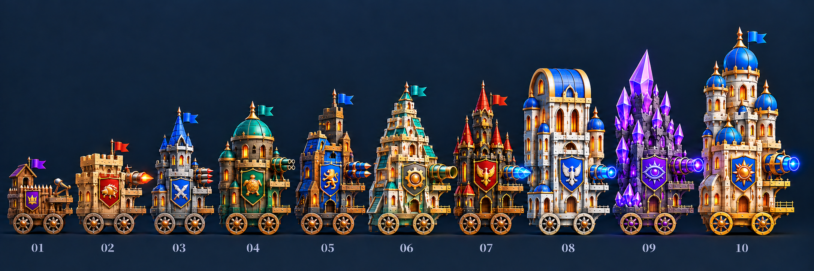

# 건축 실루엣을 구분한 성 성장 시안

내장 imagegen으로 기존 비교판을 다시 제작했다. 색과 문양뿐 아니라 건물 덩어리·지붕·첨탑의 형태를 구분한다.

1. 목조 성채
2. 직각형 보루
3. 각진 첨탑
4. 둥근 돔
5. 비대칭 금속 요새
6. 현대형 계단 피라미드
7. 고딕 성채
8. 아치·배럴볼트형 성
9. 수정 군집
10. 왕궁·어니언 돔

같은 지면과 축척에서 높이는 단계마다 증가하고, 폭 증가량은 높이 증가량의 15%를 목표로 한다. 마지막 성의 최대 높이는 사용자가 지정한 기존 6번째 성의 게임 표시 높이를 기준으로 잡았다. 단계별 목표 수치는 [design.json](design.json), 건축 변경과 높이 순서 보정 지시는 [prompts.json](prompts.json)에 기록한다.

사이드뷰와 두 바퀴, 비대칭 건축, 우측 단일 무기, 동료 및 히어로 발판을 유지하는 완성 외관 비교안이다. 높이는 깃대보다 건물·지붕의 꼭대기를 기준으로 검토하며, 8번째 성은 아치 지붕과 본체 자체를 높이도록 보정했다. 생성 비교판은 픽셀 단위의 분할 도면이나 게임 배치 검증 결과가 아니다. 기존 게임 파츠는 이 시안으로 교체하지 않았다.

