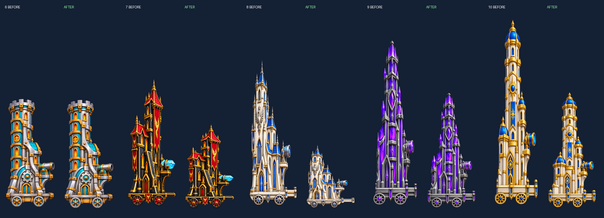

# 성 파츠 비율 복원

6~10번째 성의 기본형과 업그레이드 1~5단계를 생성 원본에서 다시 등록했다. 기존 파일명과 이미지 ID는 유지한다.

이전 등록기는 본체를 가로·세로 구간으로 나눠 고정된 바퀴·발판 좌표에 맞추고, 바퀴만 따로 원형으로 그렸다. 이 때문에 본체와 문양이 세로로 늘어났다.

새 등록기는 원본 전체에 동일한 X/Y 배율을 적용한다. 각 단계의 전체 폭을 기준으로 맞추고 아래 접지선을 정렬한다. 세로 높이는 원본 비율로 결정하며, 같은 성의 6단계는 공통 캔버스를 사용한다. 원본 자체의 높이 차이는 유지하므로, 성 단계별 높이의 단조 증가를 강제하지 않는다.

| 성 | 이전 캔버스 | 복원 캔버스 |
|---|---|---|
| 6 | 450×1024 | 450×992 |
| 7 | 390×1024 | 390×670 |
| 8 | 340×1024 | 340×448 |
| 9 | 300×1024 | 300×707 |
| 10 | 270×1024 | 270×640 |

방 개수는 각각 6~10개로 유지한다. 내부 방 공개 영역은 업그레이드 간 공통 영역에 배치한다. 히어로·동료 발판·포구·바퀴 좌표는 각 단계의 변환을 따른다. 서로 다른 파츠 단계를 조합할 때는 지붕·몸체·포탑의 연결점에 이동만 적용하며 파츠를 늘리지 않는다.

`before-uniform-registration`은 이전 조립 이미지·메타데이터, `generated-master.png`는 수정하지 않은 생성 원본이다. `parts.json`의 `scaleX`, `scaleY`는 같으며, 저장된 PNG 파츠를 재조립해 보이는 모든 RGBA 픽셀을 원본의 균일 변환 결과와 비교한다.

재등록은 `tools/castles/restore_uniform_castles.py`를 사용한다. 기존 `register_*_sd.ps1`, `split_*_sd.ps1`도 이 경로를 호출한다. `legacy_registration`의 예전 코드는 연결점 해석용으로만 읽으며 이미지를 저장하는 데 사용하지 않는다.

검증: `tools/castles/verify_uniform_castles.ps1`. 별도 저장 프로필과 미리보기 실행 파일에서 5개 성 × 7조합(기본~5단계·혼합)을 확인한다. 리소스 크기, 방 공개, 인물과 포구 좌표, 화면 폭을 검사하고 외부·내부 화면을 캡처한다.

